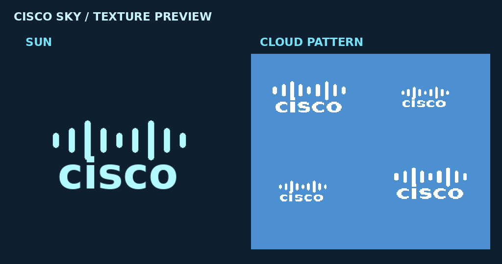

# NetLab Cisco Sky

Немного телекоммуникационного юмора над головой: солнце Cisco и фирменные облака для твоей лаборатории NetLab.

**[Скачать готовый ZIP для Minecraft 1.21.1](NetLab-Cisco-Sky-1.21.1.zip)**

## Установка

1. Скачай ZIP целиком, распаковывать его не нужно.
2. В Minecraft открой «Настройки» → «Наборы ресурсов» → «Открыть папку».
3. Положи ZIP в открывшуюся папку и включи его в списке наборов.
4. Если другой набор меняет небо, поставь Cisco Sky выше него.

Работает на Windows и Linux. Это обычный ресурспак: установка NetLab, NeoForge и дополнительных модов не требуется. Подходит и для отдельного экземпляра Prism Launcher. Шейдеры со своим небом могут перекрывать стандартные текстуры.

Исходные файлы набора находятся в каталоге [pack](pack). Контрольная сумма — в [SHA256SUMS.txt](SHA256SUMS.txt).

Фанатский шуточный набор для Minecraft; неофициальный проект сообщества NetLab.
